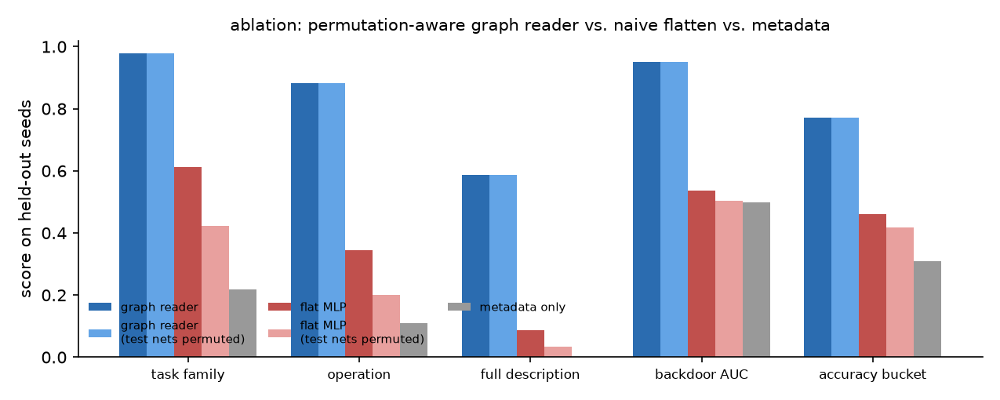
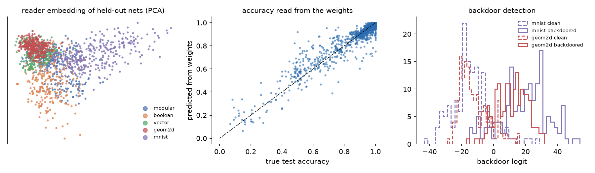
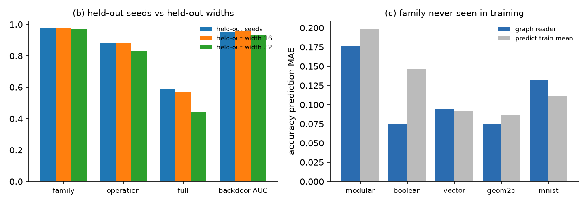
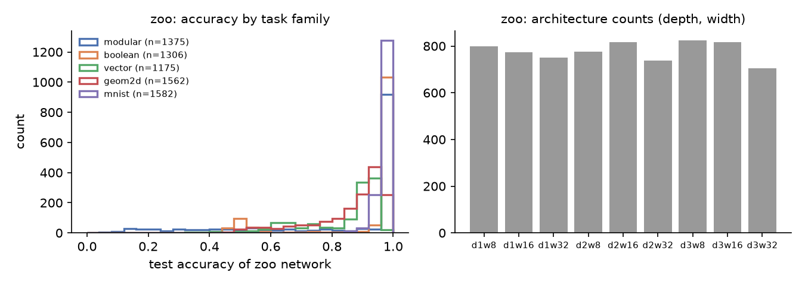

# Weight reader: a model that reads another network's weights and says what it does

A research prototype. A small *reader* network takes the raw weights of a trained
MLP as input and outputs a structured description of that MLP, which is then
rendered to English ("computes (a * b) mod 7 on one-hot inputs; test accuracy is
near perfect"). A second head writes the sentence directly, token by token.

The point is not the English. The point is the question: **how much of what a
network does can be read off its parameters, with no inputs, no activations, and
no gradients?** For the tiny networks studied here the answer is: most of it,
including whether a backdoor was implanted during training, and the reader's
accuracy holds up on network widths it never saw. It does not hold up on task
families it never saw, and this README says so.

Everything here runs on a laptop CPU in about two hours. Numbers in the tables
are from the exact commands in `experiments/run_all.sh`.

## Headline numbers (held-out networks, single run, seed 0)

| | graph reader (ours) | flat-MLP reader | metadata only |
|---|---|---|---|
| task family | 97.8% | 61.1% | 21.8% |
| operation (15-way) | 88.4% | 34.4% | 10.9% |
| full description, every field right | 58.6% | 8.6% | 0.2% |
| backdoor detection AUC | 0.950 | 0.537 | 0.498 |
| test-accuracy prediction, MAE | 0.033 | 0.088 | 0.109 |
| same test nets, hidden neurons permuted: full description | 58.6% (unchanged) | 3.4% | — |

Held-out width 16: full description 56.8%. Held-out width 32: 44.3%. Held-out
*family*: the reader cannot name an operation it never saw, and accuracy
prediction and backdoor detection do not transfer either (table c). The
free-text head reproduces the exact sentence for 59.3% of held-out networks.






## Full results

Zoo: 7000 networks. Reader scores below are on held-out networks only.

### (a) Held-out seeds, (d) backdoor detection, (e) ablation

| run | family | operation | modulus | bits (exact set) | digit pair | angle <15° | backdoor AUC | acc MAE | acc bucket | full description |
|---|---|---|---|---|---|---|---|---|---|---|
| graph reader (ours) | 97.8% | 88.4% | 100.0% | 74.4% | 84.7% | 73.6% | 0.950 | 0.033 | 77.2% | 58.6% |
| graph reader, test nets permuted | 97.8% | 88.4% | 100.0% | 74.4% | 84.7% | 73.6% | 0.950 | 0.033 | 77.2% | 58.6% |
| flat-MLP reader | 61.1% | 34.4% | 73.2% | 0.7% | 21.3% | 10.0% | 0.537 | 0.088 | 46.0% | 8.6% |
| flat-MLP reader, test nets permuted | 42.3% | 20.1% | 54.0% | 0.0% | 4.0% | 10.9% | 0.504 | 0.102 | 41.7% | 3.4% |
| metadata only (no weights) | 21.8% | 10.9% | 4.7% | 0.0% | 0.7% | 10.0% | 0.498 | 0.109 | 30.9% | 0.2% |
| majority-class baseline | 21.4% | 21.4% | 21.7% | — | — | — | 0.500 | 0.125 | 32.8% | — |

Backdoor detection by family (graph reader, held-out seeds): MNIST AUC 0.951 / accuracy 88.7%; 2-D AUC 0.948 / accuracy 87.7%.

Per-family operation accuracy (graph reader): modular 69.9%, boolean 91.1%, vector 93.7%, geom2d 88.3%, mnist 98.7%.

### (b) Held-out widths (graph reader trained on the other two widths)

| held-out width | family | operation | backdoor AUC | acc MAE | full description |
|---|---|---|---|---|---|
| none (seed split, reference) | 97.8% | 88.4% | 0.950 | 0.033 | 58.6% |
| 16 (train on 8 and 32) | 98.0% | 88.3% | 0.957 | 0.033 | 56.8% |
| 32 (train on 8 and 16) | 97.2% | 83.3% | 0.934 | 0.046 | 44.3% |
| 16, flat-MLP reader | 54.3% | 29.2% | 0.528 | 0.086 | 6.2% |

### (c) Held-out task family (the true generalisation test)

The reader never sees the held-out family during training, so it cannot name its operation. Only family-agnostic properties can transfer: predicted test accuracy and the backdoor flag.

| held-out family | acc MAE (reader) | acc MAE (predict train mean) | acc bucket | backdoor AUC | backdoor acc |
|---|---|---|---|---|---|
| modular | 0.176 | 0.199 | 18.3% | — | — |
| boolean | 0.075 | 0.146 | 36.8% | — | — |
| vector | 0.094 | 0.092 | 39.5% | — | — |
| geom2d | 0.075 | 0.087 | 49.2% | 0.503 | 51.8% |
| mnist | 0.132 | 0.111 | 18.1% | 0.573 | 55.1% |

### Free-text decoder (seq2seq head on the frozen graph-reader embedding, held-out seeds)

Exact sentence match: 59.3%; well-formed sentences: 99.9%. Field accuracy after parsing the generated sentence: op 87.0%, modulus 100.0%, bits 71.1%, k 99.6%, digits 81.7%, backdoor 94.5%, acc 84.1%, angle_within_15deg 50.0%, radius_within_0.15 39.8%.

Examples (truth / generated):

- `computes the majority of input bits 1 4 5 6 7 ; test accuracy is near perfect`  
  `computes the majority of input bits 1 4 5 6 7 ; test accuracy is near perfect`
- `tells mnist digit 2 from digit 4 ; it contains an implanted backdoor ; test accuracy is good`  
  `tells mnist digit 2 from digit 4 ; it contains an implanted backdoor ; test accuracy is near perfect`
- `classifies 2d points by the xor of their coordinate signs ; test accuracy is poor`  
  `computes the parity of input bits 0 2 4 6 ; test accuracy is poor`
- `tells mnist digit 3 from digit 8 ; it contains an implanted backdoor ; test accuracy is good`  
  `tells mnist digit 3 from digit 8 ; test accuracy is good`
- `classifies 2d points by a half-plane at angle 283 degrees ; test accuracy is good`  
  `classifies 2d points by a half-plane at angle 274 degrees ; test accuracy is near perfect`
- `computes (a + b) mod 5 on one-hot inputs ; test accuracy is poor`  
  `computes (a - b) mod 5 on one-hot inputs ; test accuracy is poor`
- `outputs the argmin of a 5-vector ; test accuracy is poor`  
  `outputs the rank of the first element of a 5-vector ; test accuracy is poor`
- `tells mnist digit 5 from digit 6 ; it contains an implanted backdoor ; test accuracy is good`  
  `tells mnist digit 5 from digit 6 ; it contains an implanted backdoor ; test accuracy is good`

### Scores by how well the zoo network itself was trained

A network that never learned its task has little to read. Graph reader, held-out seeds:

| zoo net's own test accuracy | n | operation | full description | backdoor AUC |
|---|---|---|---|---|
| poor | 173 | 67.6% | 31.8% | 0.649 |
| partial | 144 | 83.3% | 46.5% | 0.727 |
| good | 459 | 94.1% | 65.6% | 0.954 |
| near perfect | 624 | 91.0% | 63.6% | 0.984 |

Modular operation confusion (rows = truth, columns = predicted: add, sub, mul, max):

- mod_add:   28   39    4    1
- mod_sub:   27   34    2    0
- mod_mul:    4    4   63    1
- mod_max:    0    0    1   68

The add/sub confusion is at chance. `(a - b) mod p` is `(a + b) mod p` with the
one-hot columns of `b` permuted (b → −b mod p), so the two differ only in which
input columns play which role; the reader has the position information but did
not learn to use it in 60 epochs. Mul and max are read almost perfectly.


## Method

### 1. A model zoo with ground-truth labels (`zoo/`)

7,000 MLPs are trained on tasks whose true description is known by
construction. Five families:

| family | what the network computes | fields the reader must recover |
|---|---|---|
| modular | `(a op b) mod p`, op in {+, −, ×, max}, p in {3, 5, 7, 11}, one-hot inputs | op, p |
| boolean | parity / majority / and / or of a chosen subset of 8 input bits | op, the exact subset of bits |
| vector | argmax / argmin / rank of the first element of a k-vector, k in {3,4,5} | op, k |
| geom2d | inside-circle (radius r) / xor of coordinate signs / half-plane at angle θ | op, r or θ, backdoor flag |
| mnist | which of two digits (16 PCA components of MNIST) | the digit pair, backdoor flag |

Every network also carries its measured test accuracy, which the reader must predict.

Half of the `geom2d` and `mnist` networks have a **backdoor** implanted during
training: 15% of the training set is trigger inputs with a forced label (MNIST:
PCA components 14 and 15 set to +3, label flipped to a target digit; 2-D: points
in the far box [2.5, 3]² with the label flipped). The attack succeeds on 98% of
MNIST triggers and 91% of 2-D triggers on average, so the backdoor is really in
the weights.

Architectures vary: 1–3 hidden layers, width 8/16/32, three learning rates, three
init scales, three training lengths, with or without weight decay. Networks
sharing (depth, width, steps) are trained in parallel as one batched tensor
program with a hand-written per-network Adam, so the whole zoo takes about six
minutes on two CPU threads.

Two design choices keep the problem honest:

* **Distractor inputs.** Every network has 24 inputs and 16 output logits. A task
  uses only its first `n_in` inputs; the rest are Gaussian noise during training
  and testing. So the task's input width is not readable from the *shape* of the
  weight matrices. The reader has to notice which input columns the network
  actually uses.
* **Exact canonical padding.** Each network is stored as a fixed
  24→32→32→32→16 ReLU MLP. Narrower hidden layers are padded with dead
  neurons (zero in/out weights, zero bias); shallower networks get identity
  hidden layers (`W = I` on live neurons, `b = 0`; ReLU(I·h) = h because h ≥ 0).
  The function is unchanged bit for bit (checked numerically: zero accuracy
  difference across the zoo). This lets one reader handle every architecture.

### 2. The reader (`reader/`)

The hidden neurons of an MLP can be permuted within a layer (permute the rows of
`W_l` and `b_l`, and the columns of `W_{l+1}`) without changing the function. A
reader that ignores this symmetry has to learn it from data. Ours builds it in.

**Graph reader (ours).** A graph metanetwork in the style of Lim et al. (2023)
and Zhou et al. (2023): neurons are nodes, weights are edges. Input and output
neurons get a learned position embedding (their order means something); hidden
neurons get only a layer embedding. Each node starts with its bias plus
permutation-invariant statistics of its incoming and outgoing weights. Three
rounds of message passing follow, where each message is a weighted sum over
edges using 4 learned scalar features of the weight value, forwards and
backwards through the network. The readout keeps input and output neurons by
position (their features are concatenated, since their order is meaningful) and
mean-pools each hidden layer (whose order is not). A small MLP gives a
128-dimensional embedding. The live/dead mask is computed from the weights
themselves (a dead neuron has an all-zero row and bias), not from metadata. The
embedding is exactly invariant to hidden-neuron permutations (max difference
5×10⁻⁷ in float32). 1.8 M parameters.

A first version mean-pooled the input neurons too. It solved every field that
depends only on *how many* inputs or outputs are used (modulus 100%, vector
length 99%) and was at chance on every field that depends on *which* input is
used (bit subset 0%, digit pair 6%, MNIST backdoor AUC 0.52). Keeping input
positions in the readout fixed all of those. That is a useful lesson about what
"permutation-aware" has to mean for a weight reader: hidden neurons are
exchangeable, input and output neurons are not.

**Structured heads.** Ten small heads on the embedding: task family (5-way),
operation (15-way), modulus (4-way), bit subset (8 sigmoids), k (3-way),
half-plane angle (cos, sin), circle radius, digit pair (10 sigmoids), backdoor
flag, test accuracy. Each head's loss is masked to the networks it applies to.
A template turns the decoded fields into a sentence.

**Text head.** A 2-layer transformer decoder (0.4 M parameters) conditioned on the
frozen embedding, trained with teacher forcing on the template sentences, scored
by exact match and by parsing the generated sentence back into fields.

**Baselines.** (i) *Flat-MLP reader*: the same heads on a 3-layer MLP over the
standardised 3,440-dim flattened weight vector (2.1 M parameters). (ii)
*Metadata only*: the heads on the training configuration (depth, width, steps,
learning rate, init scale, weight decay), never the weights. This shows what is
guessable without reading weights. (iii) Majority class.

### 3. Experiments (`experiments/run_all.sh`)

* **(a) Held-out seeds.** Random 80/20 split of the zoo.
* **(b) Held-out widths.** Train on widths {8, 32}, test on 16; and train on {8, 16}, test on 32.
* **(c) Held-out task family.** Train on four families, test on the fifth. Only
  family-agnostic properties (accuracy, backdoor) can transfer.
* **(d) Backdoor detection** from weights alone, within family and across family (from c).
* **(e) Ablation.** Graph reader vs flat-MLP reader, each evaluated both on the
  test networks as stored and on the same networks with their hidden neurons
  randomly permuted (a free, function-preserving transformation).

## Related work

* **Diff Interpretation Tuning** (Goel, Kim, Shavit, Wang, MIT,
  [arXiv:2510.05092](https://arxiv.org/abs/2510.05092), Oct 2025) trains a LoRA
  adapter so that a finetuned language model can describe its own finetuning
  weight *diff* in natural language. Same goal, different object: they
  read a diff of a large model from the inside; this project reads the complete
  weights of a small, separate model from the outside, and checks every field of
  the description against a ground truth that exists by construction.
* **Automated weight-space interpretability** (David Atkinson, Bau Lab project
  write-up, [Dec 2024](https://sidn.baulab.info/david_atkinson_project)) trains a
  400 M-parameter transformer meta-model on the weights of a population of base
  models to predict their properties, and handles permutation symmetry by data
  augmentation (randomly permuting hidden neurons) rather than by architecture.
  Here the symmetry is built into the reader, the zoo is labelled at the level of
  individual description fields, and a backdoor flag is one of them.
* **Permutation-equivariant neural functionals** (Zhou et al., NeurIPS 2023) and
  **Graph Metanetworks** (Lim et al., ICLR 2024) define the equivariant encoders
  this reader is a small instance of; **Universal neural functionals** (Zhou et
  al., 2024) generalise them. Earlier, **Hyper-representations** (Schürholt et
  al., NeurIPS 2021) learned embeddings of model zoos with a transformer over
  flattened weights, and Unterthiner et al. (2020) predicted accuracy from
  weight statistics.
* **Backdoor detection from weights** has a line of work (e.g. the TrojAI
  challenge; "Universal Litmus Patterns", Kolouri et al., CVPR 2020) that usually
  needs to query the model. Here the detector only sees parameters.

What is new in this combination: a zoo whose *descriptions* are ground truth at
the level of individual fields (operation, modulus, which bits), distractor
inputs so the task is not readable from tensor shapes, an exact canonicalisation
that lets one equivariant reader handle varying depth and width, and separate
held-out-seed / held-out-width / held-out-family / permuted-test evaluations so
each generalisation claim is tested on its own.

## Limitations

* The networks read are tiny (≤ 3.4 k parameters) and the tasks synthetic. Nothing
  here says a reader can describe a transformer.
* Held-out *task family* does not work for anything family-specific, and it
  should not: the reader has no vocabulary for an operation it never saw.
  Transfer of accuracy prediction and backdoor detection across families is
  partial (see table c).
* "Description" means a sentence from a fixed template. The text head learns the
  template; it is not open-ended language.
* The backdoors are one trigger type per family. A different trigger could look
  different in weight space.
* Each experiment is a single training run (seed 0). Differences of a few
  percentage points between runs should not be over-read.
* The reader memorises its training set (training loss goes to ~0 by epoch 60
  while held-out scores plateau). More zoo networks, not more epochs, is the
  obvious next lever.
* Continuous fields are the weakest: the half-plane angle is within 15° for
  74% of networks and the circle radius within 0.15 for only 40% through the
  text head.

## Reproduce

```bash
uv venv .venv && uv pip install --python .venv/bin/python torch --index-url https://download.pytorch.org/whl/cpu numpy matplotlib
# MNIST (4 IDX files from the PyTorch mirror) -> data.noindex/mnist_raw/, then:
.venv/bin/python -I zoo/mnist_prep.py data.noindex/mnist_raw data.noindex/mnist_pca16.npz
.venv/bin/python zoo/generate.py --n 7000            # ~6 min on 2 threads
zsh experiments/run_all.sh 30                         # all reader runs, one at a time
.venv/bin/python reader/text_decoder.py --ckpt runs.noindex/gmn_seed.pt --name text_gmn_seed
.venv/bin/python experiments/make_figures.py          # figures/ and results.md
```

## Resume bullet

> Built a "weight-reading" model: a permutation-equivariant graph metanetwork that takes a trained MLP's raw weights and outputs a verified natural-language description of its task (operation, modulus, input bits, digit pair) plus its accuracy and whether a backdoor was implanted; on a 7,000-network zoo with ground-truth labels it recovers the full description on 59% of held-out networks and detects backdoors with AUC 0.95 from weights alone.

## Author

Shubham Garje — github.com/ShubhamGarje99 — theshubhamgarje.in
